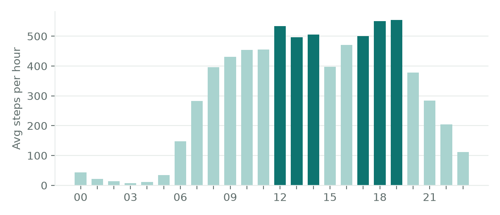
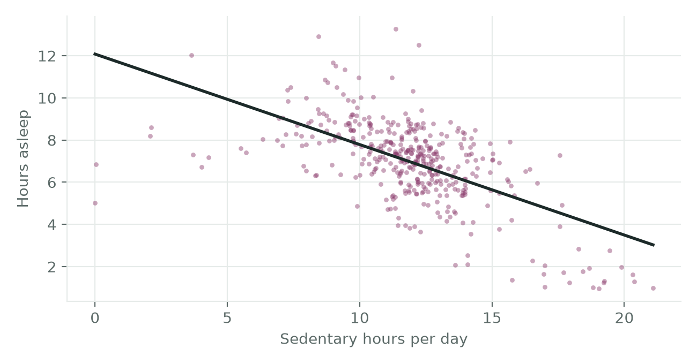
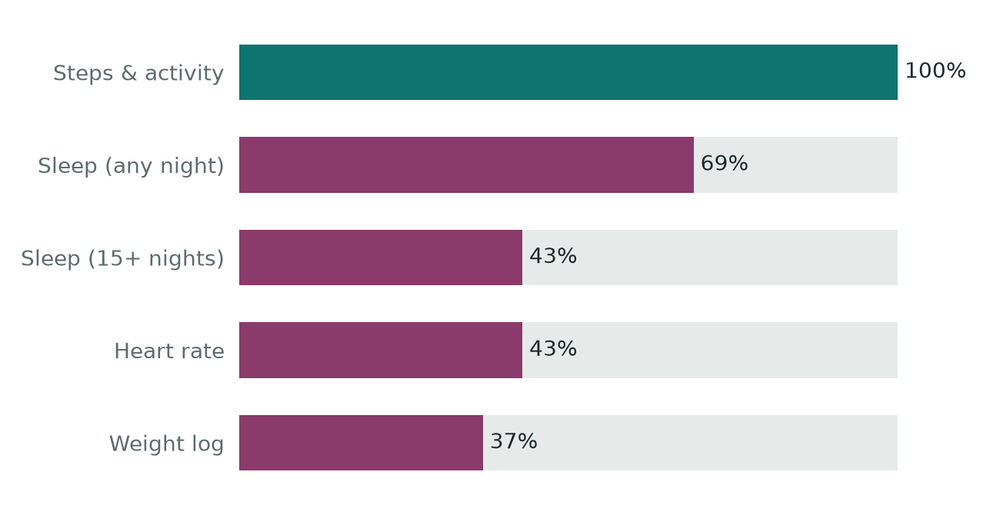

# Bellabeat Case Study: How Can a Wellness Technology Company Play It Smart?

Capstone project for the Google Data Analytics Professional Certificate. I analysed public Fitbit usage data to find smart-device habits, and turned them into marketing recommendations for the **Bellabeat app**. All cleaning and analysis is written in **SQL (DuckDB)**.

📊 **[Read the full report online](https://ppppppeter.github.io/bellabeat-case-study/bellabeat_case_study.html)** · Word version: [Bellabeat_Case_Study.docx](Bellabeat_Case_Study.docx)

## Key findings

| Finding | Number |
|---|---|
| Average steps per day | 8,169 (median 7,802) |
| Days reaching 10,000 steps | 35% |
| Waking time spent sedentary (days with sleep tracked) | ~11.9 h |
| Sleep trackers averaging under 7 h of sleep | 54% |
| Days the device was worn 23 h or more | 49% |
| Users who logged weight / heart rate | 37% / 43% |

- Activity peaks at **12:00–14:00** and **17:00–19:00**; Sunday is the least active day.
- Users are split almost evenly across four activity levels, so one fixed "10,000 steps" goal fits only about a quarter of them.
- More sedentary time goes with less sleep (r = −0.60, association only).

**Activity peaks at lunch and after work** (average steps per hour, all users)



**More sitting goes with less sleep** (each dot is one user-day with sleep tracked)



**Features that need extra effort go unused** (share of 35 users with any data)



> **About the 16-hour figure.** Across all days the device logs 16.0 sedentary hours, but on the 830 days with no sleep record it counts sleep as sedentary (18.1 h). Only the 409 sleep-tracked days separate the two, which gives **~11.9 waking hours sedentary**.

## Recommendations

1. **Market the app as a coach against sitting, not a step counter.** Send nudges after long sedentary spells, time them around the noon and early-evening peaks, and base goals on each user's own baseline.
2. **Make sleep the headline feature, linked to daytime activity.** Add wind-down reminders and a morning sleep score, and promote the Leaf as comfortable to wear overnight.
3. **Automate tracking and use it to sell the membership.** Auto-sync replaces manual logs; weekly summaries and Sunday challenges give users a taste of membership coaching.

## Data

[FitBit Fitness Tracker Data](https://www.kaggle.com/datasets/arashnic/fitbit) (CC0, Möbius): 35 users, 12 March – 12 May 2016, two exports. The data is limited: it is a small, self-selected MTurk sample from 2016 with no gender information, so treat the findings as directional. The raw data is not committed; `run_sql.py` reads it from the kagglehub cache.

## Project structure

```
sql/01_load.sql        load raw CSVs from both export periods
sql/02_clean.sql       parse dates, de-duplicate, drop non-wear days, derive columns, integrity checks
sql/03_analysis.sql    every statistic in the report, one "-- name:" block per query
run_sql.py             runs the SQL in DuckDB, fails if any check is non-zero, writes output/
output/                summary.json and cleaned tables (CSV)
report/                charts (matplotlib), Word report (docx-js), HTML report
dbt_bellabeat/         the same pipeline as a dbt project (models, tests, docs)
dbt-docs/              the generated dbt docs site (GitHub Pages)
```

## Reproduce

```bash
pip install duckdb kagglehub matplotlib
python -c "import kagglehub; print(kagglehub.dataset_download('arashnic/fitbit'))"   # prints <data path>
python run_sql.py <data path> output
python report/charts.py output/summary.json report/charts
cd report && npm install && cd ..
node report/build_docx.js output/summary.json report/charts Bellabeat_Case_Study.docx
python report/build_html.py output/summary.json bellabeat_case_study.html
```

## dbt version

🔗 **[Browse the dbt docs and lineage graph](https://ppppppeter.github.io/bellabeat-case-study/dbt-docs/)**

`dbt_bellabeat/` rebuilds the same cleaning and headline figures as a **dbt** project on DuckDB, layered the standard way:

```
staging/       stg_fitbit__*          one view per raw CSV (both export periods)
intermediate/  int_daily_parsed, int_daily_dedup   parse dates, drop duplicates, resolve the 2016-04-12 overlap
marts/         fct_daily_activity, fct_hourly_steps, fct_sleep, fct_daily_sleep, fct_weight_logs, dim_users
marts/report/  rpt_overview, rpt_weekday, rpt_hourly, rpt_activity_levels, rpt_sleep, rpt_feature_adoption
tests/         the integrity checks from 02_clean.sql, as dbt tests
```

`dbt build` creates 19 models and runs 13 data tests (unique / not-null keys, accepted values, one row per user-day and user-night, no day over 1,440 minutes, never asleep longer than in bed). Every table and report figure was compared row by row with the `run_sql.py` output: identical (1,239 user-days, 46,008 hourly rows, 410 nights; 11.9 waking sedentary hours, 8,169 average steps).

```bash
pip install dbt-duckdb "duckdb==1.5.5"
cd dbt_bellabeat
export FITBIT_DATA=<data path>          # PowerShell: $env:FITBIT_DATA = "<data path>"
dbt build --profiles-dir .
dbt docs generate --profiles-dir . --static   # target/static_index.html: model docs + lineage graph
cp target/static_index.html ../dbt-docs/index.html   # the published docs page (set FITBIT_DATA="<FITBIT_DATA>" first so no local path is embedded)
```

## 中文简介

Google 数据分析证书的 Capstone 项目。数据是 35 位 Fitbit 用户在 2016 年的使用记录，清洗和分析全部用 SQL（DuckDB）完成，最后为 Bellabeat app 提出三条营销建议：减少久坐提醒、以睡眠为主打功能、自动记录数据并借此推广会员。

另有 `dbt_bellabeat/`：把同一套清洗和统计改写成 dbt 项目（staging → intermediate → marts 分层，13 项数据测试，自动生成文档和血缘图），结果与原 SQL 流程逐行一致。
